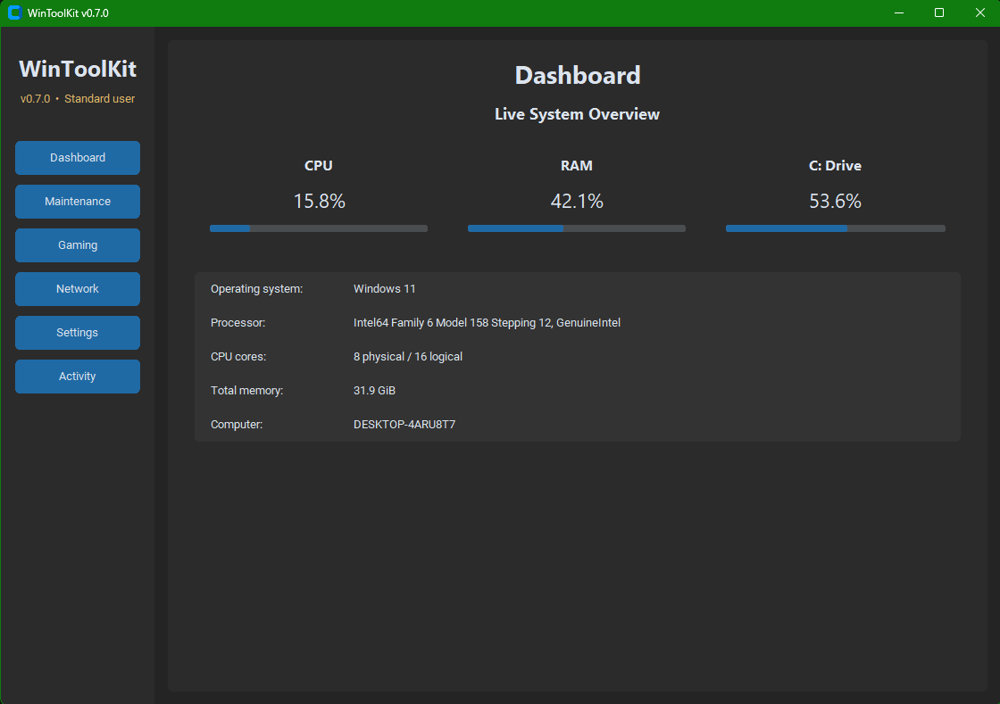
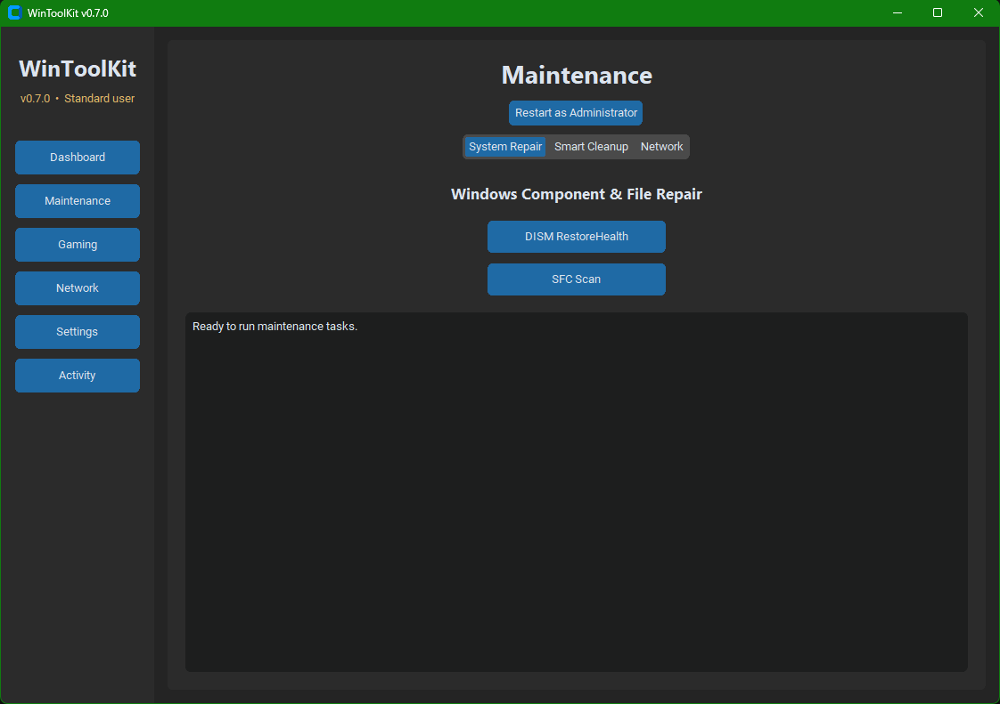
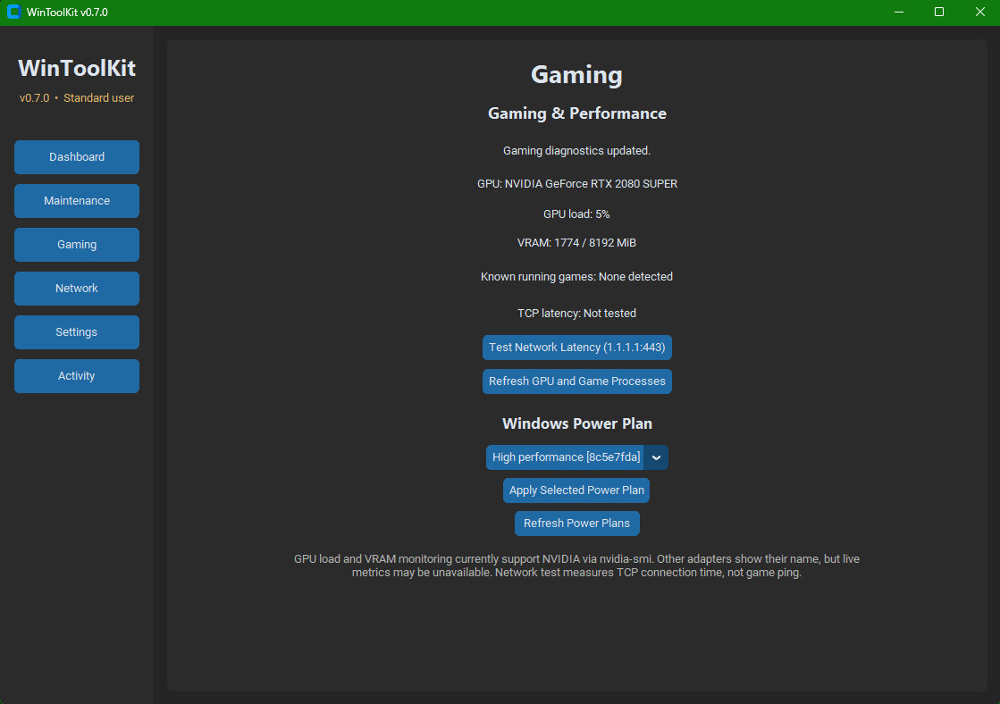

# WinToolKit

**A Windows maintenance, system monitoring, and gaming utility built with Python.**

WinToolKit is an open-source desktop application designed to bring useful Windows system tools together in one modern, easy-to-use interface.

The project is developed incrementally, with a focus on practical functionality, maintainable code, and continuous learning.

## Features

### System Dashboard

- Live CPU and RAM usage monitoring
- Disk usage monitoring
- Hardware and operating system information
- Dark-themed graphical interface

### Windows Maintenance

- DISM RestoreHealth
- System File Checker (SFC)
- DNS cache flushing
- Administrator privilege detection and elevation
- Background task execution with progress output

### Smart Cleanup

- Scan user and Windows temporary directories
- Identify temporary files older than 24 hours
- Preview cleanup results with Dry Run
- Confirm before deleting eligible files
- Skip inaccessible files and symbolic links

### Gaming & Performance

- GPU adapter detection
- NVIDIA GPU utilization and VRAM monitoring via `nvidia-smi`
- Detection of selected running game processes
- Windows power plan management
- TCP network latency testing

### Activity Logging

- Persistent maintenance activity history
- Task results and error reporting
- Logs stored locally outside the repository

## Requirements

- Windows 10 or Windows 11
- Python 3.10 or newer
- CustomTkinter
- psutil

Some system maintenance operations require administrator privileges.

## Screenshots

### Dashboard

Live system monitoring with CPU, RAM, disk usage, and hardware information.



### Maintenance

Windows repair utilities, Smart Cleanup, and activity logging.



### Gaming

GPU information, game process detection, power plans, and network latency tools.



## Installation

Clone the repository:

```bash
git clone https://github.com/Rakinos89/WinToolKit.git
cd WinToolKit
```

Create a virtual environment:

```bash
python -m venv .venv
```

Activate it in PowerShell:

```powershell
.\.venv\Scripts\Activate.ps1
```

Install dependencies:

```bash
pip install -r requirements.txt
```

Launch WinToolKit:

```bash
python main.py
```

## Development Roadmap

| Version | Milestone | Status |
|---|---|---|
| v0.1–v0.3 | Dashboard and navigation | Complete |
| v0.4 | Windows repair tools | Complete |
| v0.5 | Smart Cleanup | Complete |
| v0.6 | Improved UI and activity logging | Complete |
| v0.7 | Gaming and performance tools | Complete |
| v0.8 | AMD GPU monitoring and gaming dashboard improvements | Planned |

## Technology Stack

- **Python:** Application logic
- **CustomTkinter:** Desktop interface
- **psutil:** System and process monitoring
- **Windows utilities:** System diagnostics and maintenance
- **Git & GitHub:** Version control

## Project Status

**Current version: v0.7**

WinToolKit is actively being developed. Features are tested incrementally, and additional functionality is planned for future releases.

## Disclaimer

WinToolKit is an independent development project. System maintenance and cleanup operations can modify or delete files. Review actions carefully and use the application at your own risk.

## License

No license has been selected yet.